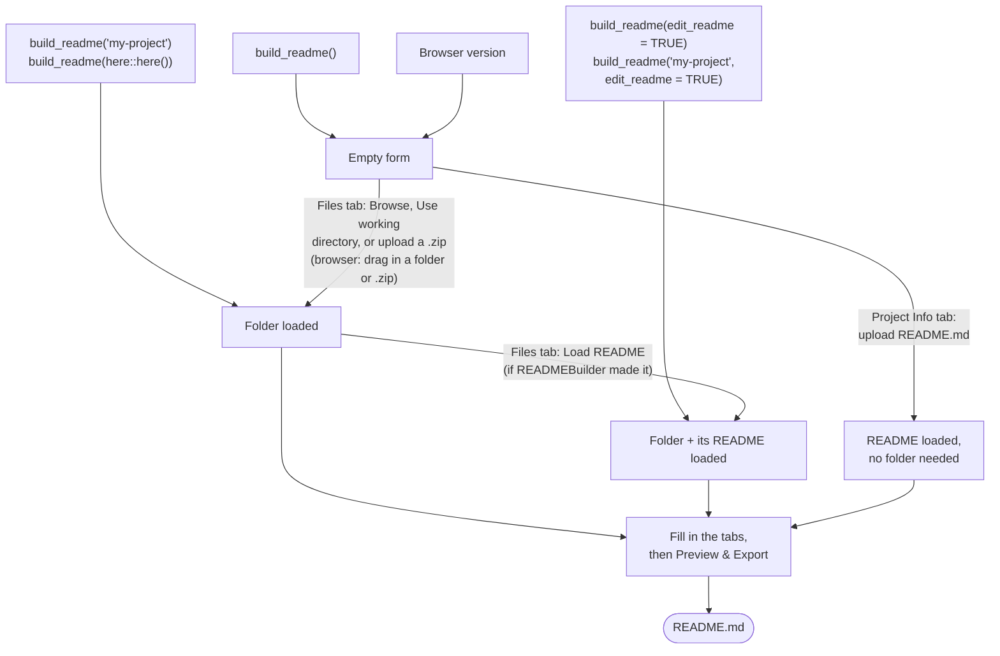

<p align="center">
  
</p>

<div align="center">
 <h1>READMEBuilder</h1>
</div>

<!-- badges: start -->
[](LICENSE.md)
<!-- badges: end -->

> [!IMPORTANT]
> **You are viewing the `development` branch.** It has new features and bug
> fixes that are not yet in the stable version on `main`, including a
> [browser version that needs no installation](#use-it-in-your-browser),
> one-click licence choices, a Source column for package versions, and many
> fixes to re-importing a README. See [what's new and
> fixed](https://github.com/EIvimeyCook/READMEBuilder/blob/development/NEWS.md)
> and [how to install either version](#installation).

READMEBuilder is an R package with an interactive Shiny app that turns a project folder into a single `README.md` documenting both **the data and the code**. 
It also runs [in your web browser](#use-it-in-your-browser), with nothing to
install.

Good documentation is what makes an analysis reproducible: not just what the data
columns mean, but which scripts to run and in what order, and which package (and
R) versions produced the results. READMEBuilder captures all of this for you. It
summarises every data file, records the script run order, detects your
dependencies and their installed versions, maps the project's directory
structure, and assembles everything into a tidy Markdown file ready to archive or
share (for example on Zenodo, Dryad, or GitHub).

## Features

- **Documents data *and* code together.** Column-level data summaries sit
  alongside the script run order, dependencies, and environment that make an
  analysis reproducible.
- **Guided, six-step workflow** from project metadata to a downloadable `README.md`.
- **Automatic data description.** Point at a folder and every tabular file is
  summarised column-by-column (types, ranges, levels, missing values).
- **Script run order.** Record the exact order scripts should be executed, each
  with a short description.
- **Dependency and environment capture.** Scans your scripts and resolves the
  installed version of every package, plus the R version.
- **Directory map.** An ASCII tree of your project, embedded in the README.
- **Separate code and data licences.** One-click buttons for the common choices
  (MIT, Apache 2.0 or GPL-3.0 for code; CC0 or CC BY 4.0 for data), or pick from
  the full list or type your own.
- **Model location and specification (MLast).** Optionally record each analysis
  and link it to the data, with *separate* fields for where the method is
  described, where the results are reported, and where the code lives.
- **Dependency libraries are skipped.** Restored `renv`/`packrat` libraries are
  excluded from scanning, so loading a project folder stays fast.
- **Built-in walkthrough.** A **How to use this app** button explains each tab;
  it also opens automatically the first time you run the app.
- **Re-open and edit.** Import a README the app made earlier and continue where
  you left off, without the original data folder. Exporting and re-importing
  gives back exactly what you entered.
- **Runs entirely on your machine.** Files are read locally and never uploaded,
  in the R package and in the browser version alike.
- **No-install browser version.** The same app [runs in a web
  browser](#use-it-in-your-browser): drag your project folder (or a `.zip`)
  onto the page.

## Use it in your browser

**<https://eivimeycook.github.io/READMEBuilder/>**

The browser version is the same app, running entirely inside your browser
(through [Shinylive](https://posit-dev.github.io/r-shinylive/) and
[webR](https://docs.r-wasm.org/webr/latest/)). There is nothing to install,
and your files are never sent anywhere: the folder you choose (or your zip) is
read by R running in the page itself. It is built from the `development` branch.

To use it:

1. On the **Files** tab, drag the top level of your project folder (not a
   subfolder) from Finder or File Explorer onto the **Drag your project folder
   here** box. You can also click **Choose folder…**, but browsers then ask
   whether to "upload" the files (Safari always, Chrome and Edge in some
   set-ups). That is only their standard wording for letting a page read a
   folder: the files are read by the page and never sent anywhere. Dragging
   avoids the prompt. A zipped folder works too: drop it on the same box or use
   **Upload .zip…** (up to 500 MB). To zip a folder on macOS: right-click ›
   **Compress**; on Windows: right-click › **Send to** › **Compressed (zipped)
   folder**.
2. Work through the tabs as usual, then click **Download README.md**.

Folders such as `renv/` and `.git/`, and hidden files, are left out before
anything is read, so choosing a project with a restored `renv` library stays
fast.

How it differs from the R package:

- **No Use working directory, and no opening a folder by path.** A web page
  cannot see your disk on its own, so you choose the folder (or a zip) each
  time; `build_readme("folder")` and **Use working directory** exist only in
  the R package.
- **Package versions come only from an `renv.lock`.** The browser cannot see
  the packages installed on your computer, so packages missing from the lockfile
  are listed as `not recorded`, and the R version is shown as `—` unless the
  lockfile records one. Add an `renv.lock` to the project to record them, or import a
  README made by the R package: its versions are kept for any package the
  lockfile does not cover.
- **The first visit is slow.** The page downloads R itself (about 90 MB) the
  first time; later visits are faster.
- **The walkthrough is remembered by your browser.** It opens on your first
  visit only (using the browser's local storage); in a private window it opens
  every time.

Everything else (data summaries, script order, models, importing and editing an
existing README) works the same as in the R package.

## Installation

READMEBuilder is not on CRAN. Install it from GitHub. There are two versions:

**Stable version** (the `main` branch):

```r
install.packages("pak")
pak::pak("EIvimeyCook/READMEBuilder")
```

**Development version** (the `development` branch), with the latest features and
bug fixes ([what's new and
fixed](https://github.com/EIvimeyCook/READMEBuilder/blob/development/NEWS.md)):

```r
pak::pak("EIvimeyCook/READMEBuilder@development")
```

To check which version you have, run `packageVersion("READMEBuilder")`: 0.2.0 is
the stable version and 0.2.1 the development version. To switch between them,
run the other install command.

## Usage

```r
library(READMEBuilder)
build_readme()
```

This opens the Shiny app in your browser. To open it with a project folder
already loaded, pass the folder: an absolute path, a path relative to the
working directory, or one built with `here::here()`. Add `edit_readme = TRUE`
to also fill the form from a `README.md` that READMEBuilder made earlier (see
[Editing an existing README](#editing-an-existing-readme)):

```r
build_readme(".")                          # the working directory
build_readme("~/projects/my-study")        # any folder
build_readme(here::here())                 # the project root, via {here}
build_readme(edit_readme = TRUE)           # working directory + its README.md
```

### Ways in



Passing a folder to `build_readme()` loads only its files: the folder's README
is used only if you add `edit_readme = TRUE`. Uploading a README on the
**Project Info** tab works without the original folder, but the data summaries
then come from the README rather than from the data. If you upload a README
first and load the folder afterwards, the README's descriptions are kept for
every file the folder still has.

The app is organised into six steps, shown in the navigation (on the left, or
across the top on a phone):

1. **Project Info:** title, description, abstract, instructions, DOI(s),
   citation text, authors (with ORCIDs), affiliations, contact, funders, and
   acknowledgements. Code and data are licensed **separately**: choose each from
   a list or type your own value (for example `CC-BY-4.0`); a typed value is
   kept even if you click away without pressing Enter, and the **×** clears it.
   ORCID iDs typed after an author's name become links in the README. You can
   also upload an existing README here to reload and edit it (see
   [Editing an existing README](#editing-an-existing-readme)).
2. **Files:** browse to your project folder, or click **Use working directory**
   to load the folder `build_readme()` was called from (handy when the project
   is already open in RStudio, Positron, VS Code or similar), or upload the
   folder as a `.zip`. In the browser version, drag the folder (or a `.zip`)
   onto the drop box, or use **Choose folder…** or **Upload .zip…**. A
   directory map of the folder
   is shown and included in the export. Tabular files are described
   automatically (see [What gets auto-detected](#what-gets-auto-detected)); add a
   description for each column (and units for numeric columns), plus the date(s)
   and location of data collection.
3. **Script Order:** reorder your code with the up/down arrows to record the
   sequence it should be run in, and add a short description of what each script
   does. Scripts are described here rather than on the Files tab.  
4. **R Packages:** runs automatically when a folder is loaded (click **Scan**
   to run it again). It scans every R script (`.R`, `.Rmd`, `.qmd`, `.Rnw`) for
   `library()`, `require()`, `requireNamespace()`, `pacman::p_load()`,
   `librarian::shelf()`, `import::from()`, `groundhog.library()` and `pkg::fun`
   calls, then resolves each package's version (base R packages such as `stats`
   and `utils` are left out). Only R code is
   scanned: comments, text inside strings, and the prose of R Markdown / Quarto
   documents (outside code chunks) are ignored, as are calls such as
   `library(pkg, character.only = TRUE)` where the package name is a variable.
   If the folder contains an `renv.lock`, the versions (and R version) recorded
   there are used in preference to what is installed; a **Source** column in the
   package table says where each version came from. If there are several
   `renv.lock` files, the one at the top of the project is used (otherwise the
   first one found), and the app says so; a lockfile that cannot be read is
   reported rather than silently ignored.  
5. **Models (optional):** record each analysis and where it lives — see
   [Recording models (MLast)](#recording-models-mlast). Leave this tab empty and
   no Models section is added.
6. **Preview & Export:** a live Markdown preview. The **Download README.md**
   button sits in the bottom-right corner on every tab, so you can save at any
   point.

## What gets auto-detected

When you load a folder, files are sorted into three groups by extension:

| Group | Extensions | What happens |
| :---- | :--------- | :----------- |
| Tabular data | `.csv` `.tsv` `.txt` `.xlsx` `.xls` | Read and summarised column-by-column |
| Code / scripts | `.R` `.Rmd` `.qmd` `.Rnw` | Listed on **Script Order**; scanned for packages |
| Everything else | any | Listed under **Other Files** for a free-text description |

Each column in a tabular file gets an automatic summary:

| Column type | Auto-summary |
| :---------- | :----------- |
| Numeric | range, mean, and number of `NA`s |
| Categorical (character / factor) | the levels (if ≤ 10) or a unique-value count, and `NA`s |
| Date / datetime | min–max range and `NA`s |
| Logical | counts of `TRUE`, `FALSE`, and `NA` |

Files that look tabular by extension but do not parse cleanly are quietly
skipped and listed under **Other Files** for a free-text description instead.
A `.txt` file is only treated as a table if it is tab-delimited, so prose notes
are not summarised as fake tables. A file with a header row but no data still
gets its columns listed (marked "no data rows"), and CSVs saved by Excel on
Windows (Windows-1252 rather than UTF-8) are read with their accents intact.

For Excel workbooks with more than one sheet, the first sheet that has any data
is summarised (so an empty cover sheet is skipped), and the README lists the
names of all sheets.

Column names, and file and folder names, can contain any characters (spaces,
brackets, `:`, backticks, accents, and so on). Office lock files (`~$book.xlsx`),
`Thumbs.db` and `desktop.ini` are not part of a project and are left out.

## What the output looks like

The generated `README.md` includes a title, DOI badges, separate **code** and
**data** licence badges, the project metadata, a directory map, per-file variable
tables, the ordered script list, and an R environment table.

A directory map looks like this:

````text
MyProject/
├── data/
│   └── data.csv
├── analysis.R
├── README.md
└── report.Rmd
````

Each tabular file gets a variable table:

**Dimensions:** 150 rows × 2 columns

**Variables:**

| Column | Type | Description | Units | Summary |
| :----- | :--- | :---------- | :---- | :------ |
| `habitat` | categorical | Habitat type | | levels: A, B, C, D, E \| NAs: 0 |
| `caterpillar_count` | numeric | Caterpillars per survey | count | range 2–36 \| mean 15.11 \| NAs: 0 |


And the code and environment are recorded so the analysis can be rerun:

````text
## Code
Scripts should be run in the following order:

1. **`analysis.R`**

   Load and clean data, fit the model, produce Figure 1.

2. **`report.Rmd`**

   Render the results into a report.

## R Environment
**R version:** 4.5.2

| Package | Version | Source |
| :------ | :------ | :----- |
| `dplyr`   | 1.1.4 | installed |
| `ggplot2` | 3.5.1 | installed |
````

The **Source** column reads `renv.lock` for versions taken from the lockfile,
`installed` for versions installed on the machine that generated the README,
`not installed`, or (in the browser version) `not recorded` for packages the
lockfile does not list. If a project mixes sources, a note under the table says
so.

Text you type is written as Markdown, so you can use links, lists, code blocks
and so on. A single line break inside a paragraph is kept as a line break when
the README is shown on GitHub (it is written with a trailing `\`, which the app
removes again on import).

If you fill in the optional **Models** tab, a models table is included too:

## Models

| Outcome (paper) | Outcome (data) | Predictors (data) | Test | Methods location | Results location | Code location | Notes |
| :--- | :--- | :--- | :--- | :--- | :--- | :--- | :--- |
| Proportion scrounging | PropPS | Opponent_propPS_average | Linear Regression | Methods, p.4 | Table 2, p.7 | sem.R:3 | Type III SS |

## Getting help inside the app

The **How to use this app** button at the bottom of the navigation opens a
short walkthrough of what each tab is for. It also opens by itself the first
time you launch the app, and then not again — the fact that you have seen it is
recorded in a small marker file under `tools::R_user_dir("READMEBuilder",
"config")`. Delete that file to see the walkthrough again on next launch. In the
browser version it is remembered in your browser's local storage instead.

## Recording models (MLast)

The **Models** tab is entirely optional — leave it empty and nothing is added to
your README. It is, however, one of the most useful things you can fill in. It
records a *Model Location and Specification Table* (MLast): for each analysis,
what was modelled, which data columns it used, and where to find it. 

The idea is adapted from the Model Location and Specification Table proposed by
Jones et al. ([2026](https://doi.org/10.64898/2026.04.07.26350286)), *Challenges
in the Computational Reproducibility of Linear Regression Analyses*, with one
deliberate change.

**"location" is split into three separate fields.** The original proposal
has a single `Location` column, which leaves it ambiguous whether you should cite
where a method is *described* or where its results are *reported*. Here they are
distinct, and a third field records the code:

| Field | What it records | Example |
| :---- | :-------------- | :------ |
| Outcome (paper) | Outcome as named in the manuscript | `Proportion scrounging` |
| Outcome (data) | Matching column name in the data | `PropPS` |
| Predictors (data) | Predictor column names | `Opponent_propPS_average` |
| Test | Model or test type | `Linear Regression` |
| Methods location | Where the analysis is **described** | `Methods, p.4, para 2` |
| Results location | Where the output is **reported** | `Table 2, p.7` |
| Code location | Script and line | `sem.R:3` |
| Notes | Anything else | `Type III SS` |

Rather than typing line numbers by hand (they go stale as soon as a script is
edited), **Suggest from loaded scripts** searches the scripts in your loaded
project folder for the outcome or first predictor and offers each match as a
`script:line` option with a preview of the line. Scripts in subfolders are given
by their path within the project (for example `analysis/sem.R:3`), so scripts
with the same name in different folders can be told apart. Load a project folder on the
**Files** tab first.

The result is written to the README as a `## Models` table, and is restored when
you re-import that README later.

## Dependency folders are skipped

If you have run `renv::restore()`, your project folder contains a full local copy
of every dependency's source under `renv/library` — often tens of thousands of
files. Scanning those is slow, treats every package's internal `.R` files as if
they were your own scripts, and pollutes the detected dependency list.

READMEBuilder therefore skips the following when loading a folder, scanning for
packages, and searching for code locations:

```text
renv    packrat    .Rproj.user    .git      .Rcheck
venv    .venv      node_modules   .quarto   __pycache__   __MACOSX
```

(`__MACOSX` is the folder of hidden metadata that macOS adds to zips.) Loading a
folder that holds nothing else says so, rather than just "no files found".

The whole `renv/` directory is skipped, not just `renv/library`: `renv/activate.R`
is a bootstrap script renv generates rather than anything you wrote, and its own
`requireNamespace("renv")` call would otherwise add renv to your dependency list
and put `activate.R` in your script run order.

`renv.lock` is **not** affected — it sits at the project root rather than inside
`renv/`, so package and R versions are still read from it exactly as before.

## Editing an existing README

On the **Project Info** tab, upload a `README.md` previously produced by
READMEBuilder; it is imported as soon as you choose it (**Import / Re-import**
loads it again, for example to undo edits). The app parses the file and
repopulates the whole form (project info, the file list and directory map,
per-column descriptions and units, the script run order and descriptions, any
recorded models, and the R / package versions) so you can edit and re-export
*without* needing the original data folder. **Clear** resets everything to a
blank README, after asking.

Exporting a README and importing it again gives back exactly what you entered,
including multi-line descriptions, code blocks, and text containing Markdown
headings, `---`, `<...>`, or lines that look like the README's own structure
(such as `## Description` or `**Location:**`). Such text is escaped with a
backslash in the export, so GitHub shows it as you typed it and the importer
does not mistake it for a section; the escape is removed again on import.

Importing replaces what is in the form, so the app asks first whenever the form
already has content, and also if the file does not look like a README made by
READMEBuilder. If a project folder is loaded at the time, it is kept: the
README's descriptions are matched to the folder's files.

You can also edit a README straight from its project folder. Run
`build_readme(edit_readme = TRUE)` from the project (or
`build_readme("path/to/project", edit_readme = TRUE)`), or load the folder on
the **Files** tab and click **Load README** when asked. The form is filled from
the folder's top-level `README.md`, while the file list and data summaries come
from the folder itself, so new files show up and removed ones drop out. A
README not made by READMEBuilder is left alone.

The importer is deliberately tolerant of older or hand-edited files (for example
a `## Funders` or `## Funding` heading, and single- or split-licence wording).
File-level content is reconstructed from the README itself; to refresh the
auto-summaries from the underlying data, re-load the project folder on the
**Files** tab.

## Privacy

`build_readme()` launches a Shiny app that runs locally on your computer. Your
files and their contents stay on your machine: folder browsing, file reading, and
package resolution all happen locally, and nothing you load is uploaded to any
server.

The [browser version](#use-it-in-your-browser) works the same way: the web page
contains R itself (webR), and the folder you choose (or your zip) is read inside
the page. The website only supplies the app's files; it never receives yours.

The one exception is cosmetic. The app's theme asks your browser to load the
Inter font from Google Fonts. No file data is included in that request, and if
it cannot be reached (offline, or behind a strict firewall) the app still starts
and simply uses your system font.

## Requirements

READMEBuilder depends on the following R packages, installed automatically with
the command above:

`shiny`, `bslib`, `shinyFiles`, `dplyr`, `readr`, `readxl`, `stringr`, `purrr`
and `fs`.
`jsonlite` is optional: it is used to read `renv.lock`, and the lockfile step is
skipped if it is not installed. Install it with `install.packages("jsonlite")`.

## Tips and limitations

- The directory map lists directories before files and sorts each level
  alphabetically, so the order in the map may differ from the order files appear
  on disk.
- A column's **description** and **units** are typed by you; only the **summary**
  column is generated automatically.
- Importing reloads metadata and structure but not the data itself. Re-load the
  folder if you want summaries recomputed from current files.
- The **Models** tab is filled in by you. Only the code location can be
  suggested automatically, and only for scripts in the loaded folder.
- In the browser version, package versions come only from an `renv.lock` (see
  [Use it in your browser](#use-it-in-your-browser)).

## Bug reports and contributions

Please file issues and feature requests at
<https://github.com/EIvimeyCook/READMEBuilder/issues>. Pull requests are welcome.

**Before reporting a bug, please install the development version (see
[Installation](#installation)) and check whether the problem is still there.**
Many bugs are already fixed on the `development` branch; they are listed in
[NEWS.md](https://github.com/EIvimeyCook/READMEBuilder/blob/development/NEWS.md).
When you file an issue, please include the output of
`packageVersion("READMEBuilder")` and `sessionInfo()`.

## Citation

If READMEBuilder helps with your work, please cite it:

> Ivimey-Cook, E. R. (2026). *READMEBuilder: Build high-quality READMEs for
> reproducible research* R package.
> <https://github.com/EIvimeyCook/READMEBuilder>

A machine-readable [`CITATION.cff`](CITATION.cff) is included, so GitHub's
"Cite this repository" button gives formatted APA and BibTeX.

## License

Released under the [MIT License](LICENSE.md).

## AI Declaration

Claude Sonnet 4.6 and Opus 4.8/5.5 were used in the development of this package.
